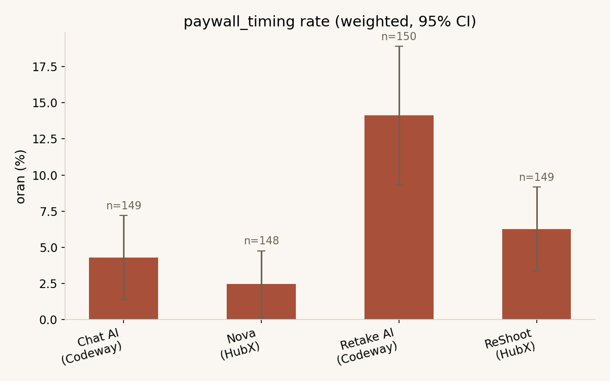
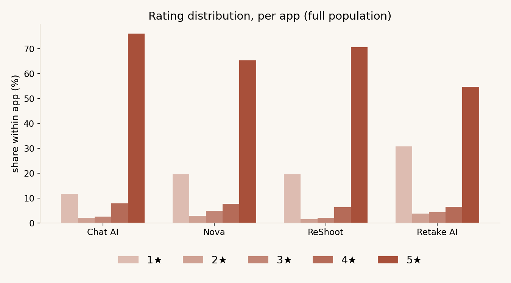

# Mobile Apps: Funnel Friction Analysis

Conversion-friction analysis from App Store reviews, comparing two Turkish AI app studios as matched pairs within the same verticals.

Comparing arbitrary popular apps can't separate a studio's monetization choices from category norms. Holding the vertical fixed (chatbot vs chatbot, face editor vs face editor) makes the remaining difference attributable to the studio itself, not the category it competes in.

## Demo

<!-- screen recording goes here -->

The Flask UI takes a natural-language question; the system either generates and runs weighted SQL or does a semantic search over reviews, and says so when it doesn't have enough data to answer.

## Runs entirely locally

No external API calls. `gemma3:4b` (structured extraction), `nomic-embed-text` (embeddings), Ollama, SQLite. Hardware: 2020 MacBook Pro, Intel i5, 8 GB RAM, no GPU. 998 records were extracted over two nights, 6 hours 41 minutes of LLM time. The model was chosen by benchmarking four candidates, not by default — see [FINDINGS.md](FINDINGS.md) for the comparison.

## Findings

- The studio difference isn't uniform — it's absent in the chatbot pair, present in the face-editor pair
- Paywall timing provokes a harsher reaction than price
- Face editors stop the user before they've even seen the product

Full write-up, method and limitations: [FINDINGS.md](FINDINGS.md)




## Query layer

Flask UI plus a CLI (`src/ask.py`). Numeric questions are routed to generated SQL; open-ended questions go to semantic search. Rate queries are restricted to the stratified estimation frame and weighted accordingly, and the generated SQL is always shown back to the user. For multilingual search, the query is translated into the target market's language before it's embedded, since semantic search otherwise stays locked to the question's own language.

## Setup

```bash
pip install -r requirements.txt          # dependencies
python src/collect_reviews.py            # fetch App Store reviews into data/raw/
python src/db.py && python src/load_to_db.py  # create schema, load reviews into SQLite
python src/embed.py                      # embed reviews with nomic-embed-text
python src/cluster.py --k 12 --save      # cluster embeddings, persist cluster_id
python src/sample.py                     # select the stratified + purposive extraction sample
python src/extract.py --frame all        # run structured LLM extraction (long-running)
python src/analyze.py                    # compute weighted rates, CIs, charts, observations.csv
python src/hypotheses.py --engine ollama # generate A/B test hypotheses from observations.csv
python src/ask.py "your question"        # or: python src/web.py, for the browser UI
```

## Repo layout

```
config/     apps.json and other configuration
src/        all scripts
data/raw/   raw JSON (gitignored)
data/       friction.db, embeddings.npy
output/     csv, charts, reports
site/       static page for publishing
```

`output/hypotheses_ollama.md` and `output/hypotheses_claude.md` are hypotheses generated from the exact same observations by two different models — kept side by side in the repo for comparison.
